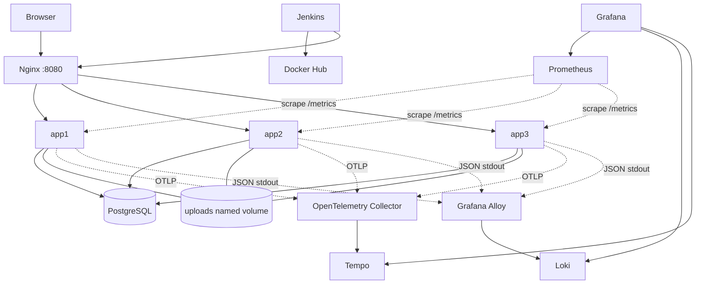

# Portfolio CRUD — Go, Docker Compose, CI/CD và Observability

Portfolio CRUD là một modular monolith viết bằng Go, render HTML phía server và chạy ba app instances phía sau Nginx. Project được thiết kế cho môi trường homelab để thực hành Backend, Docker, PostgreSQL, bảo mật web, Jenkins, Prometheus, Grafana, Loki và OpenTelemetry.

> **Trạng thái xác minh:** source/config đã được rà soát tĩnh trong môi trường tạo artifact. Môi trường này không có Docker/Compose và không truy cập được `proxy.golang.org`, vì vậy chưa thể xác nhận build image, khởi động đủ 12 container, truy vấn thật trong Loki/Tempo hoặc end-to-end. Xem [`VERIFICATION.md`](VERIFICATION.md) để biết chính xác các kiểm tra đã chạy và chưa chạy. Trên máy có Internet, cần chạy `go mod tidy` để tạo `go.sum`, kiểm tra dependency rồi commit file này trước khi release.

## 1. Tính năng

- Public: trang chủ, danh sách project có phân trang, chi tiết project; chỉ project `published` được công khai.
- Admin: đăng nhập/đăng xuất, dashboard thống kê, CRUD project, draft/published, upload/thay thumbnail và xóa thumbnail.
- Bảo mật: Argon2id, server-side session trong PostgreSQL (chỉ lưu hash session token), CSRF, rate limit, security headers/CSP, Host allowlist, parameterized SQL, URL HTTPS validation, upload JPEG/PNG qua decode và giới hạn kích thước. App dùng database role không có quyền superuser; bootstrap DB role riêng.
- Vận hành: health/readiness endpoints, graceful shutdown, PostgreSQL connection pool, Docker non-root, Nginx load balancing.
- Observability: Prometheus metrics, JSON logs qua stdout/stderr → Alloy → Loki, trace HTTP/DB → OTLP Collector → Tempo; Grafana datasource/dashboard được provisioning.
- CI/CD: Jenkins pipeline có format, vet, tests, coverage, `govulncheck`, build image, Trivy scan; publish/deploy chỉ trên `main`/tag được tin cậy.

## 2. Kiến trúc



Compose defines exactly 12 long-running services: `app1`, `app2`, `app3`, `postgres`, `nginx`, `jenkins`, `grafana`, `prometheus`, `loki`, `tempo`, `otel-collector`, `alloy`. One-shot migration/integration/smoke containers are temporary jobs, not persistent services.

### Network và cổng host

| Service | Host port mặc định | Ghi chú |
|---|---:|---|
| Website / Nginx | `127.0.0.1:8080` | Điểm truy cập website duy nhất |
| Grafana | `127.0.0.1:3000` | Dashboard, cần login |
| Jenkins | `127.0.0.1:8081` | CI/CD; không mở Internet trực tiếp |
| PostgreSQL, Prometheus, Loki, Tempo, OTLP | Không publish | Chỉ network nội bộ |

Các networks `app_net`, `db_net`, `obs_net` là internal; `edge_net` cho các dịch vụ cần host-side port hoặc quản trị. Mỗi ứng dụng chỉ kết nối các network cần thiết. Các named volumes lưu database, uploads, Jenkins home, Grafana, Prometheus, Loki, Tempo và Alloy.

**Đây không phải HA toàn hệ thống.** PostgreSQL, Nginx và telemetry backends vẫn là điểm lỗi đơn. Ba Go instances giúp cân bằng request và duy trì phục vụ khi một app instance lỗi, không giải quyết lỗi database/host.

## 3. Yêu cầu trước khi cài

- Linux host có Docker Engine và Docker Compose v2 plugin.
- Git, `curl`, `openssl`, Python 3 (scripts setup dùng Python để ghi `.env`).
- Kết nối Internet trong lần build đầu để tải base images và Go dependencies; image build pin Go `1.27.2` (module directive `go 1.27.0`).
- Khuyến nghị khởi đầu: 6 vCPU, 16 GB RAM, SSD còn dung lượng trống. Máy nhỏ hơn có thể cần hạ retention và theo dõi RAM/disk.
- Tên miền/HTTPS nếu định mở public. Mặc định ports chỉ bind loopback, an toàn hơn cho lab.

## 4. Quick start

Từ bản source đã giải nén:

```bash
chmod +x scripts/*.sh
./scripts/setup.sh
```

`setup.sh` tạo `.env` với secrets ngẫu nhiên riêng cho bootstrap PostgreSQL, role ứng dụng và Grafana, bind `PROJECT_DIR` về đường dẫn tuyệt đối của thư mục hiện tại và đặt permission `0600`. Script initialization tạo app role không có superuser/createdb/createrole và một database riêng cho integration tests. Các file `/docker-entrypoint-initdb.d` chỉ chạy ở lần khởi tạo PostgreSQL đầu tiên; nếu đã có volume cũ, cần thực hiện migration/role provisioning thủ công hoặc dùng một volume mới (xóa volume sẽ xóa dữ liệu). Script **không** mở cổng ra Internet. Sau đó kiểm tra `.env`:

```bash
nano .env
# Kiểm tra PROJECT_DIR, POSTGRES_USER/DB, ALLOWED_HOSTS,
# PUBLIC_BASE_URL, COOKIE_SECURE, APP_HOST_PORT, DOCKER_GID.
```

Trước khi build lần đầu hoặc mở PR, trên máy có Go và Internet hãy tạo module checksum và lưu vào Git:

```bash
go mod tidy
git add go.mod go.sum
git commit -m "Add Go module checksums"
```

Sau đó khởi động:

```bash
docker compose config
docker compose up -d --build
docker compose ps
docker compose logs --tail=100 app1 postgres nginx
```

Chờ `app1`, `app2`, `app3`, `nginx`, `postgres` và dịch vụ observability chuyển sang `healthy`. Lần khởi động đầu có thể mất thời gian tải image và build. `app1` thực hiện migration trước khi serve; `app2`/`app3` chờ `app1` khỏe để tránh tranh migration ban đầu.

Tạo tài khoản admin đầu tiên bằng lệnh tương tác (mật khẩu không echo ra terminal):

```bash
./scripts/create-admin.sh
```

Truy cập:

- Website: <http://127.0.0.1:8080>
- Admin: <http://127.0.0.1:8080/admin/login>
- Grafana: <http://127.0.0.1:3000>
- Jenkins: <http://127.0.0.1:8081>

Grafana dùng `GRAFANA_ADMIN_USER` / `GRAFANA_ADMIN_PASSWORD` trong `.env`. Jenkins initial unlock password lấy bằng `docker compose exec jenkins cat /var/jenkins_home/secrets/initialAdminPassword` nếu màn hình setup yêu cầu. Plugin Jenkins cần được khởi tạo theo danh sách pin trong image; sau lần khởi động đầu có thể mất vài phút.

## 5. Cấu hình biến môi trường

| Biến | Mục đích |
|---|---|
| `PROJECT_DIR` | Đường dẫn tuyệt đối đến thư mục chứa `compose.yaml`; do setup script thiết lập |
| `POSTGRES_DB`, `POSTGRES_USER`, `POSTGRES_PASSWORD` | Database chính và bootstrap administrator của PostgreSQL; password bootstrap chỉ dành cho initialization/health checks |
| `APP_DB_USER`, `APP_DB_PASSWORD` | Role không phải superuser được ứng dụng và integration tests sử dụng |
| `TEST_DB_NAME` | Database riêng cho integration tests (mặc định `portfolio_test`) trong cùng PostgreSQL container |
| `APP_IMAGE` | Image mà Compose sử dụng; mặc định `portfolio-crud:local` |
| `APP_HOST_PORT` | Host port website; mặc định 8080 trên localhost |
| `GRAFANA_HOST_PORT`, `JENKINS_HOST_PORT` | Host ports quản trị; mặc định 3000/8081 trên localhost |
| `GRAFANA_ADMIN_USER`, `GRAFANA_ADMIN_PASSWORD` | Tài khoản Grafana |
| `SESSION_TTL` | Thời hạn session; mặc định 12 giờ |
| `COOKIE_SECURE` | Phải bật `true` sau khi TLS kết thúc tại trusted reverse proxy/HTTPS |
| `PUBLIC_BASE_URL` | Base URL public; đổi sang HTTPS origin của bạn khi deploy |
| `ALLOWED_HOSTS` | Host allowlist ứng dụng; thêm hostname thực tế nếu dùng domain |
| `TRUST_PROXY_HEADERS` | Chỉ bật khi request vào app luôn đi qua reverse proxy tin cậy |
| `OTEL_TRACES_SAMPLER_ARG` | Sampling ratio từ 0 đến 1; lab mặc định 1.0 |
| `DOCKER_GID` | GID của docker.sock trên host để Jenkins CLI truy cập daemon |

Không đưa file `.env` lên Git hay gắn vào bug report/log. Nếu domain thực tế được cấu hình trong Nginx, thêm hostname không kèm port vào `ALLOWED_HOSTS`.

## 6. CRUD qua giao diện

1. Mở `/admin/login` và đăng nhập.
2. Tạo project với title, slug duy nhất, summary, description, technologies ngăn cách bằng dấu phẩy, GitHub/demo URL HTTPS và trạng thái.
3. Có thể upload JPEG hoặc PNG tối đa 5 MiB; file được decode, giới hạn pixel, đặt tên ngẫu nhiên và lưu trên shared named volume `uploads_data`.
4. Chọn `published` để project xuất hiện ở `/projects`; draft không được trả qua public repository queries.
5. Sửa project từ danh sách admin; checkbox “Remove thumbnail” dùng để xóa ảnh hiện tại. Xóa project yêu cầu xác nhận browser.

Schema hiện dùng UUID, `TEXT[]` cho technologies, ràng buộc unique slug và check constraints cho status/slug/độ dài. Migrations nằm trong `migrations/`.

## 7. Luồng observability

### Metrics

Prometheus scrape từng instance (`app1:8080`, `app2:8080`, `app3:8080`) trên `/metrics`; không scrape qua Nginx. Dashboard có request rate, latency histogram, HTTP 5xx/error rate, app instance health và Go runtime. Alert rules mẫu theo dõi instance down và 5xx rate cao.

Ví dụ PromQL:

```promql
sum by (app_instance) (rate(http_server_requests_total[5m]))

histogram_quantile(0.95,
  sum by (le) (rate(http_server_request_duration_seconds_bucket[5m]))
)

sum(rate(http_server_requests_total{status=~"5.."}[5m]))
/
clamp_min(sum(rate(http_server_requests_total[5m])), 0.001)
```

### Logs

Go ghi JSON ra stdout/stderr. Alloy tail Docker JSON log files ở `/var/lib/docker/containers` bằng read-only mount, parse envelope và JSON fields, rồi gửi đến Loki. Không mount Docker socket vào Alloy; tuy nhiên, collector cần quyền đọc host Docker log files. Labels cố ý không dùng request ID/trace ID nhằm tránh cardinality cao.

LogQL mẫu:

```logql
{service="portfolio-app"}
{service="portfolio-app", level="ERROR"}
{service="portfolio-app"} | json | status >= 500
```

### Traces

Go HTTP instrumentation và spans ở repository tạo trace/span. SDK gửi OTLP gRPC tới `otel-collector:4317`; Collector forward tới Tempo. Với sampling ratio 1.0 ở lab, có thể dễ quan sát từng request. Trong Grafana chọn Tempo → Search để tìm request vừa gửi. Mở Loki và tra theo `trace_id` trong JSON log để đối chiếu.

Sau khi chạy app, tạo traffic rồi kiểm chứng:

```bash
./scripts/verify-observability.sh
```

Script yêu cầu Prometheus có `up=1` cho cả ba instances, Grafana có đủ datasource, Loki có log app và Tempo có trace. Nếu Tempo chưa có trace ở lần kiểm tra đầu tiên, tạo thêm traffic, chờ export, rồi chạy lại; đồng thời xem logs của app/collector.

## 8. Kiểm thử

```bash
# Kiểm tra format, vet, unit tests và coverage
./scripts/test.sh

# Kiểm tra các service/luồng end-to-end khi Compose đang chạy
./scripts/acceptance.sh

# Integration test PostgreSQL (tạm thời cần Docker image Go tải được)
./scripts/integration-test.sh

# Theo dõi logs

docker compose logs -f app1 app2 app3 nginx postgres
```

Nếu không có `TEST_DATABASE_URL`, `tests/integration` sẽ skip; đặt biến này để chạy CRUD/unique slug/database error tests trên database test riêng. Không chạy integration test trên database chứa dữ liệu cần giữ vì test tạo/xóa dữ liệu và dùng migration schema.

Các lệnh acceptance:

```bash
docker compose config
docker compose up -d --build
docker compose ps
go test ./...
go vet ./...
curl -i http://127.0.0.1:8080/healthz
curl -i http://127.0.0.1:8080/readyz
curl -i http://127.0.0.1:8080/projects
./scripts/smoke.sh
./scripts/verify-observability.sh
```

`./scripts/curl-crud.sh` hỏi tài khoản admin, tự lấy CSRF token từ HTML rồi thực hiện đăng nhập, tạo project tạm, đọc danh sách/chi tiết, cập nhật và xóa project. Nó cần site đang chạy, credentials admin hợp lệ và `curl`/Python 3.

Muốn kiểm tra load balance, script smoke gửi 30 request và xác nhận đã thấy các header `X-App-Instance: app1`, `app2`, `app3`. Để kiểm tra failover thủ công:

```bash
docker compose stop app2
for i in $(seq 1 10); do curl -fsS http://127.0.0.1:8080/healthz >/dev/null || exit 1; done
# 10 request vẫn thành công trong lúc app2 dừng.
docker compose start app2
./scripts/smoke.sh
```

## 9. Jenkins, GitHub webhook và Docker Hub

### 9.1. Kết nối Jenkins

1. Mở `http://127.0.0.1:8081`, hoàn tất initial setup nếu được yêu cầu.
2. Tạo Multibranch Pipeline hoặc Pipeline-from-SCM trỏ tới GitHub repository.
3. Trong GitHub repository, đặt Webhook URL về endpoint Jenkins có thể truy cập từ GitHub. Webhook `http://127.0.0.1:8081` không thể nhận webhook từ Internet; cần hostname HTTPS reachable, VPN/tunnel có kiểm soát hoặc runner/agent đặt ở network phù hợp. Không port-forward Jenkins thẳng ra Internet.
4. Chọn webhook events tối thiểu là push và pull request/branch indexing phù hợp với job policy.

### 9.2. Jenkins Credentials

Tạo Credentials với ID chính xác:

| ID | Loại | Nội dung |
|---|---|---|
| `dockerhub-username` | Secret text | Docker Hub username |
| `dockerhub-token` | Secret text | Docker Hub access token với quyền cần thiết |
| `portfolio-runtime-env` | Secret file | Bản `.env` runtime đã được review, `PROJECT_DIR` là đường dẫn tuyệt đối trên Docker host |

Jenkins chạy cùng Docker host, mount `/var/run/docker.sock`; quyền điều khiển socket trên thực tế rất mạnh, gần tương đương quyền quản trị host. **Không chạy Jenkinsfile từ fork hoặc pull request chưa tin cậy trên Jenkins này.** Chỉ build/publish/deploy nhánh/tag đáng tin cậy. Jenkins không chạy `privileged`; tuy vậy socket access vẫn là rủi ro nghiêm trọng. Cân nhắc tách build worker hoặc dùng remote build service cho môi trường quan trọng.

Pipeline làm checkout, gofmt, vet, unit tests/coverage, database integration tests trên branch `main`, `govulncheck`, build, Trivy image scan, publish image và deploy chỉ trên `main`/tag. Deployment chạy smoke test và cố gắng quay lại image đã triển khai trước nếu smoke fail.

### 9.3. Điều kiện publish/deploy

- Multibranch job cần nhận diện `main` đúng là branch deploy tin cậy.
- File Credentials `portfolio-runtime-env` phải phản ánh runtime Compose hiện hành và host path thật.
- Docker Hub token chỉ có scope cần thiết; không sử dụng mật khẩu tài khoản chính.
- Khi pipeline fail, xem stage failure và không bỏ qua lỗi vulnerability scan mà không có quyết định/risk acceptance rõ ràng.
- Rollback image không tự động rollback database migration. Migration phải giữ tương thích ngược; migration phá hủy cần quy trình riêng.

## 10. HTTPS / triển khai ngoài localhost

Compose mặc định chỉ bind vào loopback. Để dùng public domain, nên triển khai một TLS reverse proxy ở trước host/edge network, cấu hình HTTPS/HSTS sau khi TLS được kiểm chứng, đặt `COOKIE_SECURE=true`, đổi `PUBLIC_BASE_URL=https://your-domain`, thêm domain vào `ALLOWED_HOSTS`, giới hạn firewall và chỉ expose cổng 80/443. Jenkins/Grafana vẫn nên truy cập VPN hoặc mạng quản trị, không mở công khai không bảo vệ.

Không dùng `TRUST_PROXY_HEADERS=true` khi app có thể được truy cập trực tiếp bởi client không tin cậy; rate limit lấy client IP từ X-Real-IP khi bật trust proxy. Đảm bảo proxy ghi đè header thay vì chuyển tiếp giá trị client tùy ý.

## 11. Backup, retention và sizing

Named volumes giữ dữ liệu qua việc recreate container, không phải backup. Backup tối thiểu PostgreSQL bằng `pg_dump` và archive/copy `uploads_data`, sau đó test restore định kỳ. Không chỉ copy dữ liệu khi database đang ghi nếu chưa đảm bảo tính nhất quán.

- Prometheus retention: 7 ngày.
- Loki retention: 168 giờ / 7 ngày.
- Tempo block retention: 48 giờ.
- Nếu disk/RAM tăng nhanh, xem `docker stats`, `docker system df`, retention và log size. Mỗi service còn có thể tạo logs riêng qua Docker JSON log driver.

## 12. Xử lý lỗi thường gặp

**Compose báo `Set PROJECT_DIR`:** chạy `./scripts/setup.sh` trước, hoặc đảm bảo `.env` có đường dẫn tuyệt đối chính xác.

**Ứng dụng không start / `connection refused`:** xem `docker compose logs postgres app1 otel-collector`; xác minh mật khẩu PostgreSQL, readiness, DNS/network, collector và quyền volume.

**Login bị 403:** lấy form mới để nhận CSRF cookie/token; xác nhận browser nhận cookie; nếu HTTPS thì bật `COOKIE_SECURE=true` chỉ sau khi TLS proxy cấu hình đúng.

**Host bị từ chối:** thêm hostname không kèm port vào `ALLOWED_HOSTS`, sửa `PUBLIC_BASE_URL` và kiểm tra `Host` qua Nginx.

**Image upload không lưu:** xem `docker compose logs app1`; xác minh shared `uploads_data`, quyền filesystem non-root và định dạng thực JPEG/PNG (SVG/WebP hiện không nhận).

**Prometheus target down:** kiểm tra `docker compose ps`, app health, `deploy/prometheus/prometheus.yml`, đường DNS tới từng app.

**Loki không thấy logs:** xem logs Alloy; trên Linux xác minh Docker dùng `json-file` logging driver và log files host đọc được. Alloy dùng một read-only mount của Docker log path và không hỗ trợ mọi logging driver.

**Tempo trống:** gửi HTTP traffic mới, chờ batch exporter, xem `docker compose logs app1 app2 app3 otel-collector tempo`; xác minh OTLP gRPC 4317 và mạng `obs_net`.

**Jenkins không deploy/không tìm thấy path:** `portfolio-runtime-env` cần host-side `PROJECT_DIR`; Docker socket dùng đường dẫn phía Docker host, không phải path container. Đọc stage log trước khi thử chạy lại.

**Lỗi tải Go modules:** cần outbound Internet/DNS tới proxy/module hosting ở lần đầu; đảm bảo `go.sum` đã được tạo/commit từ máy có mạng và không xóa checksum khi CI build.

## 13. Tài liệu liên quan

- [`SECURITY.md`](SECURITY.md): phạm vi, giả định, rủi ro và hardening.
- [`VERIFICATION.md`](VERIFICATION.md): các lệnh đã chạy và những kiểm tra chưa thể thực thi trong môi trường tạo ZIP.
